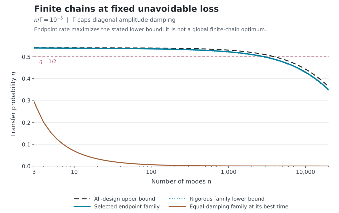

# Directional Quantum Relay Limits

**Optimal state transfer through static, passive, nearest-neighbor one-way chains.**

A local directed chain can retain a nonzero transmission probability across arbitrarily many ideal relays. Its best static design nevertheless retains the familiar emitter–receiver pulse mismatch. This repository determines that optimum, constructs a family approaching it with bounded local couplings, and obtains the exact optimized transmission law when weak unavoidable loss accumulates along the chain.

## Physical task

An arbitrary quantum state occupies the first of $`n\geq2`$ oscillator modes. All other modes and environmental inputs start in vacuum. A time-independent number-conserving Hamiltonian and linear loss operators produce the drift $`A`$, and the last physical mode is retained at a chosen time $`t`$.

The complete drift is **lower bidiagonal**, with no upstream or bypass couplings: propagation is only from a site to its immediate downstream neighbor. Physical passivity requires

```math
A+A^\dagger\preceq0.
```

The retained mode undergoes a pure-loss channel, up to a known phase, with transmissivity

```math
\eta(t)=\left|[e^{At}]_{n1}\right|^2.
```

For a single initial excitation, $`\eta`$ is its arrival probability. It is not the average fidelity of an arbitrary input state. The [model](science/model.md) and [channel consequences](science/channel_consequences.md) make these operational distinctions explicit.

## Exact design limits

Every allowed chain length, static coefficient choice, detuning and readout time satisfies

```math
\eta(t)\leq \frac{4}{e^2}=0.541341\ldots .
```

This bound is a sharp supremum for each length. The [proof](science/path_ceiling.md) combines a classical sharp weighted-shift product bound with a positive convolution representation of the transfer amplitude. The two-emitter constant and the product inequality have prior origins; the [attribution account](references/related_work.md) identifies them.

The [attaining family](science/attainable_designs.md) uses bounded coefficients in its local loss operators and coherent hoppings. By slowing its endpoints, it removes the algebraic dilution of the equal-damping chain. For $`m=n-2`$, internal amplitude damping $`\Gamma`$ and endpoint amplitude damping $`a`$, an explicit readout time and amplitude bound are

```math
t=\frac{m}{\Gamma}+\frac1a,
\qquad
\left|[e^{At}]_{n1}\right|
\geq\frac2e\left(1-\frac{ma^2}{\Gamma^2}\right).
```

The endpoint tuning and elapsed time are part of the construction. For $`n\geq3`$, reaching the zero-extra-loss ceiling exactly would require a limiting design.

### Unavoidable loss

Let $`\Gamma`$ cap each mode's **engineered diagonal amplitude damping**, and add independent unavoidable amplitude damping $`\kappa`$ to every mode. The [loss frontier](science/loss_frontier.md) gives the finite upper bound

```math
\eta\leq\frac4{e^2}
\left(\frac{\Gamma}{\Gamma+\kappa}\right)^{2(n-1)}.
```

It also establishes the complete optimized weak-loss limit:

```math
\frac{n\kappa_n}{\Gamma}\longrightarrow x
\quad\Longrightarrow\quad
\eta_n^{\mathrm{opt}}\longrightarrow\frac4{e^2}e^{-2x}.
```

Here the optimum is over all allowed static designs and readout times. The finite bound need not be attained at fixed positive loss. A separate exact reduction shows that every interior engineered damping rate can be chosen equal to $`\Gamma`$; the remaining finite optimization is over the two endpoint rates and time. Equality of the two endpoint rates is not assumed in that reduction.



The figure compares evaluated physical designs and rigorous bounds. Its [finite examples](science/finite_examples.md) and [reproduction instructions](REPRODUCIBILITY.md) distinguish these curves from an unproved global finite-chain optimizer.

## Quantum communication and the role of topology

Combining the optimized transfer law with the established pure-loss capacity threshold determines the asymptotic largest number of path modes supporting positive ordinary unassisted quantum capacity:

```math
\frac{\kappa}{\Gamma}\,n_{\max}
\longrightarrow\frac{\ln 8-2}{2}
=0.03972077\ldots
\qquad(\kappa/\Gamma\to0).
```

This is a statement per independently initialized channel use. A throughput or physical-distance claim additionally needs a reset and spacing model. [Channel consequences](science/channel_consequences.md) separates ordinary capacity from two-way-assisted communication.

The path assumption has a concrete boundary. An [exact three-mode passive bypass](science/bypass.md) achieves

```math
\eta=\frac4{e^2}\left(1+\frac1{\pi^2}\right)
=0.596190\ldots .
```

Multiple forward paths can therefore exceed the chain ceiling. Ordinary common-waveguide cascades generally contain such downstream couplings. The [physical interpretation](science/physical_interpretation.md) explains the relation to local reservoir engineering, scattering, and other passive transfer architectures.

## Reading routes

| Goal | Start here |
|---|---|
| Understand the complete argument | [Scientific account](science/README.md) |
| Check assumptions and quantum channel | [Model](science/model.md) |
| Follow the sharp ceiling and its classical ingredients | [Path theorem](science/path_ceiling.md) |
| Inspect a physical design and its time cost | [Attainable designs](science/attainable_designs.md) |
| Follow finite bounds and matched limits | [Loss frontier](science/loss_frontier.md) |
| Compare earlier results and models | [Related work and references](references/related_work.md) |
| Reproduce the numerical checks and plots | [Reproducibility](REPRODUCIBILITY.md) |

## Learn the project

The single educational anchor is **Howard M. Wiseman and Gerard J. Milburn, *Quantum Measurement and Control* (2010)**. The [Wiseman–Milburn bridge](learning/WISEMAN_MILBURN_BRIDGE.md) connects its treatment of Markov dynamics, Lindblad positivity, Heisenberg evolution and linear quantum systems to this project's passive path. It translates the rate conventions, develops a two-mode example and explains the additional proof ingredients supplied here.

The [30-milestone map](learning/MILESTONES.md) has **12 background/preliminaries milestones** and **18 narrative/innovation milestones**. The first phase builds the physical and mathematical contract; the second connects local passivity and the convolution mechanism to the complete transfer law, design costs, loss frontier and architectural boundary. The map is a common understanding route, with dependencies and pointers to the authoritative scientific pages.

Use the bridge alongside the map; the book supports the route without requiring a cover-to-cover reading. The [LLM reading guide](llms.txt) provides direct study, theorem and reproduction routes.

## Reproduce the finite checks

Install the [pinned requirements](verification/requirements.txt), then run from the repository root:

```bash
python3 scripts/verify_science.py
python3 scripts/make_figures.py
```

The first command checks the physical generator and consequential finite formulas; the second regenerates both figures and their numerical tables. [Reproducibility](REPRODUCIBILITY.md) states the expected outputs and numerical limits. Finite checks illustrate and verify implementations of the analytical account; the written arguments establish the general bounds.

## Purpose and contact

This repository serves as a record of the work and a guide for the author’s self-directed learning. For discussion or potential collaboration, please contact Ruge Lin at [gogoko699@gmail.com](mailto:gogoko699@gmail.com).
