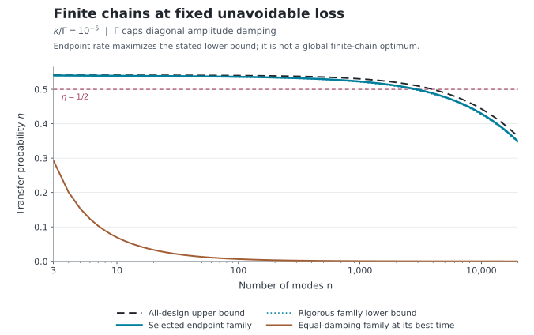
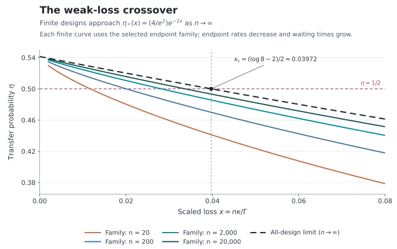

# Finite designs, bounds, and reproducible examples

The [loss frontier](loss_frontier.md) gives an upper bound for every admissible path and an explicit family that attains the optimized weak-loss limit. This page evaluates that family at finite size. The endpoint rate is chosen by maximizing a rigorous lower bound, so every displayed design is specified without numerical optimization over all generators.

Throughout, $`\Gamma`$ caps the **engineered diagonal amplitude damping**. Additional uniform amplitude damping is $`\kappa`$, implemented by jumps $`\sqrt{2\kappa}\,a_j`$. The corresponding occupation damping rates are twice the amplitude rates. The complete drift, rather than only its Hamiltonian part, must be lower bidiagonal. See the [model](model.md) for the operational assumptions.

## An explicit finite endpoint choice

For $`n\ge3`$, put $`m=n-2`$. Use the [local slow-endpoint construction](attainable_designs.md):

```math
\nu_1=\nu_n=a,\qquad
\nu_j=\Gamma\quad(2\le j\le n-1),
```

```math
w_1=w_{n-1}=\sqrt{2a\Gamma},\qquad
w_j=\Gamma\quad(2\le j\le n-2),\qquad
0\lt a\le\Gamma/2.
```

The extra restriction $`a\le\Gamma/2`$ keeps every drift hopping at most $`\Gamma`$. It is sufficient for the figures, but it is not part of the general diagonal-rate budget. Read out at the declared time

```math
t_* = \frac{m}{\Gamma}+\frac1a.
```

Let $`y=a/\Gamma`$, $`\delta=\kappa/\Gamma`$, and $`C_0=4/e^2`$. The finite lower bound is

```math
L_n(y,\delta)
=C_0\exp[-2\delta(m+1/y)](1-my^2)^2,
\qquad my^2\le1.
```

For $`\delta>0`$, its interior stationary point solves

```math
\frac{\partial}{\partial y}\log L_n
=\frac{2\delta}{y^2}-\frac{4my}{1-my^2}=0,
```

or equivalently

```math
\boxed{2my^3+\delta my^2-\delta=0.}
```

The polynomial is strictly increasing for positive $`y`$, starts below zero, and is positive at $`y=1/\sqrt m`$. Its unique positive root therefore lies in the region where the lower bound is valid. The selected rate is this root clipped at $`y=1/2`$. This is the constrained maximum of the stated lower bound. It does not optimize the exact transfer probability, the readout time, or the unrestricted finite-chain problem.

The implementation solves the well-conditioned equation

```math
2u^3+\beta u^2-\beta=0,
\qquad u=\sqrt m\,y,\qquad \beta=\delta\sqrt m,
```

on $`u\in[0,1]`$. No multidimensional optimizer is used. At zero additional loss the lower-bound supremum instead requires $`a\to0`$ and $`t_*\to\infty`$, so the finite-rate plotted curves start at positive loss.

## Exact evaluation of the selected design

For $`S\sim\mathrm{Gamma}(m,\text{ rate }\Gamma)`$, the transfer amplitude is

```math
G_\kappa(t)
=e^{-\kappa t}\,
\mathbb E\!\left[2a(t-S)e^{-a(t-S)}\mathbf1_{\{S\le t\}}\right].
```

Let $`b=\Gamma-a>0`$ and let $`P(s,z)`$ be the regularized lower incomplete gamma function. Integrating the gamma density gives

```math
G_\kappa(t)
=2a\exp\!\left[-(a+\kappa)t-m\log\!\left(1-\frac a\Gamma\right)\right]
\left[tP(m,bt)-\frac m b P(m+1,bt)\right].
```

This is the formula used for the figures. The verification script compares it with independent numerical integration and matrix exponentiation. The combined exponential avoids separately forming the potentially large factor $`(\Gamma/b)^m`$.

Every selected point is bracketed by

```math
L_n(y,\delta)
\le |G_\kappa(t_*)|^2
\le U_n(\delta),
\qquad
U_n(\delta)=C_0(1+\delta)^{-2(n-1)}.
```

The upper bound applies to all allowed designs and times; the lower bound belongs to the explicit family. The [internal-rate reduction](loss_frontier.md#2-exact-reduction-of-the-finite-size-optimization) shows that an exact time-optimized solution can take every internal rate equal to $`\Gamma`$. It leaves the two endpoint rates and readout time to optimize and does not establish equal optimal endpoints.

## Fixed additional loss



Here $`\kappa/\Gamma=10^{-5}`$. The blue solid curve evaluates the selected design exactly, the blue dotted curve is its rigorous lower bound, and the black dashed curve bounds every design. Their near agreement at small accumulated loss is visible without treating the finite upper bound as an attained optimum.

The brown benchmark has equal engineered diagonal rates $`\nu_j=\Gamma`$ and saturates the passive path-product inequality. For $`n\ge3`$, its endpoint drift couplings are $`\sqrt2\,\Gamma`$ and its internal drift couplings are $`\Gamma`$. Thus “homogeneous” refers to the diagonal rates. It satisfies the same diagonal-rate budget as the other curves. Writing $`k=n-1`$, its exact best time and probability are

```math
\Gamma t_{\mathrm{eq}}=\frac{k}{1+\delta},\qquad
\eta_{\mathrm{eq}}^{\max}
=4(1+\delta)^{-2k}
\left(\frac{k^ke^{-k}}{k!}\right)^2.
```

The benchmark includes optimization over its readout time. The endpoint family uses the declared $`t_*`$ above. At fixed positive loss both have attenuation, while endpoint engineering removes the equal-diagonal family's algebraic dilution in the weak-loss regime. The fixed-loss exponential rate of the all-design optimum is proved separately in [loss frontier](loss_frontier.md#3-equal-diagonal-rates-attain-the-fixed-loss-exponent).

For a concrete point, $`n=2000`$ and $`\kappa/\Gamma=10^{-5}`$ give

```math
\frac a\Gamma=0.001355996891,\qquad
\Gamma t_*=2735.464818,
```

```math
0.5087614581
\le \eta_{\mathrm{family}}=0.5106305564
\le \eta_{2000}^*(10^{-5})
\le0.5201253499.
```

The family lower bound already exceeds $`1/2`$, the positivity threshold for ordinary unassisted pure-loss quantum capacity under the [stated use convention](channel_consequences.md). This statement concerns capacity per channel use; the displayed waiting time is part of the physical cost.

## Approach to the weak-loss frontier



The horizontal variable is the accumulated scaled loss $`x=n\kappa/\Gamma`$. Each colored curve uses the same cubic endpoint rule at the indicated finite $`n`$. The dashed curve is the proved optimized limit

```math
\lim_{n\to\infty}\eta_n^*(x/n)
=\eta_*(x)=\frac4{e^2}e^{-2x}.
```

Its intersection with $`\eta=1/2`$ is

```math
x_c=\frac{\log 8-2}{2}=0.03972077084\ldots.
```

This is an asymptotic threshold. It is not the exact threshold of a finite chain or of the plotted finite family.

For fixed $`x>0`$, the chosen cubic root has

```math
\frac{a_n}{\Gamma}
\sim\left(\frac x2\right)^{1/3}n^{-2/3},
\qquad
\Gamma t_*=(n-2)+\frac{\Gamma}{a_n}=n+O(n^{2/3}).
```

Thus the endpoint rates decrease while the readout time grows. Loss is charged throughout this time, including endpoint emission and capture. The convergence is achieved with bounded local coefficients, not with a fixed endpoint rate or an omitted waiting-time cost.

The following values use $`x=0.02`$, hence $`\kappa/\Gamma=0.02/n`$. The limiting probability is $`0.5201148435`$.

| Modes $`n`$ | Endpoint rate $`a/\Gamma`$ | Readout time $`\Gamma t_*`$ | Family lower bound | Exact family probability | All-design upper bound |
| ---: | ---: | ---: | ---: | ---: | ---: |
| 20 | 0.03011959038 | 51.200983 | 0.472822123 | 0.480272109 | 0.521166010 |
| 100 | 0.01003434641 | 197.657712 | 0.490366796 | 0.495162297 | 0.520324991 |
| 500 | 0.003417870322 | 790.579854 | 0.502268163 | 0.505185088 | 0.520156870 |
| 2,000 | 0.001355996891 | 2,735.464818 | 0.508761458 | 0.510630556 | 0.520125350 |
| 20,000 | 0.0002922449495 | 23,419.787106 | 0.514806552 | 0.515686234 | 0.520115894 |
| 200,000 | 0.00006297960022 | 215,876.157315 | 0.517643729 | 0.518054492 | 0.520114949 |

The rows through $`n=2000`$ are independently checked by sparse matrix exponentiation. The two larger rows use the analytic gamma formula. This finite sequence illustrates the proved limit; it neither determines an optimal convergence rate nor proves general monotonicity in $`n`$.

## A check of the architectural boundary

The [three-mode bypass example](bypass.md) has the passive drift

```math
A=\begin{pmatrix}
-1&0&0\\
-2&-1-2\pi i&0\\
-2&-2&-1
\end{pmatrix}.
```

At $`t=1`$,

```math
[e^A]_{31}=e^{-1}\left(-2-\frac{2i}{\pi}\right),\qquad
\eta=\frac4{e^2}\left(1+\frac1{\pi^2}\right)
=0.5961904573\ldots.
```

The verification constructs the drift independently from its jump and Hamiltonian, then checks the matrix exponential against this exact expression. Its value exceeds $`4/e^2`$ because there is a direct $`1\to3`$ edge in addition to the relay path. Passivity remains satisfied; the unique-path condition does not.

All numerical inputs, residuals, curve data, and reproduction commands are listed in [REPRODUCIBILITY](../REPRODUCIBILITY.md).
